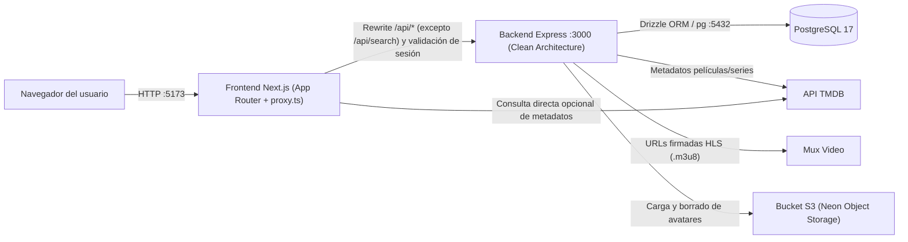
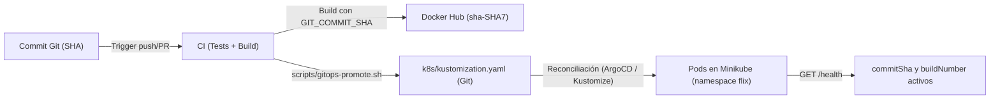

# Flix

Repositorio unificado (monorepo) de la plataforma de streaming **Flix**. Centraliza el código del frontend web (`frontend/`), la API REST (`backend/`), la configuración de base de datos, los contenedores Docker y los pipelines de integración continua.

- Demo desplegada: https://flix-murex-alpha.vercel.app
- Documentación por módulo:
  - Frontend: [frontend/README.MD](frontend/README.MD)
  - Backend: [backend/README.md](backend/README.md)
  - Especificación de la API: [backend/api-docs/README.md](backend/api-docs/README.md) y [backend/api-docs/openapi.json](backend/api-docs/openapi.json)

---

## Tabla de contenido

1. [Arquitectura y flujo de datos](#1-arquitectura-y-flujo-de-datos)
2. [Estructura del repositorio](#2-estructura-del-repositorio)
3. [Topología Git y sincronización de subtrees](#3-topología-git-y-sincronización-de-subtrees)
4. [Requisitos](#4-requisitos)
5. [Variables de entorno](#5-variables-de-entorno)
6. [Ejecución local (sin Docker)](#6-ejecución-local-sin-docker)
7. [Ejecución con Docker Compose](#7-ejecución-con-docker-compose)
8. [Base de datos, migraciones y datos semilla](#8-base-de-datos-migraciones-y-datos-semilla)
9. [Scripts disponibles](#9-scripts-disponibles)
10. [Pruebas automatizadas](#10-pruebas-automatizadas)
11. [Integración continua (GitHub Actions y Jenkins)](#11-integración-continua-github-actions-y-jenkins)
12. [Trazabilidad de entrega y GitOps (De Commit a Pod)](#12-trazabilidad-de-entrega-y-gitops-de-commit-a-pod)
13. [Configuración, seguridad y manejo de secretos](#13-configuración-seguridad-y-manejo-de-secretos)
14. [Documentación de la API](#14-documentación-de-la-api)

---

## 1. Arquitectura y flujo de datos

Flix separa la presentación web (Next.js App Router) de la lógica de negocio y persistencia (Express + Drizzle ORM + PostgreSQL 17), apoyándose en servicios externos para metadatos de catálogo (TMDB), streaming HLS (Mux) y almacenamiento de avatares (S3).



### Flujos principales de datos

1. **Autenticación y control de acceso:** El usuario inicia sesión o se registra desde `/login` o `/register`. `proxy.ts` reenvía las rutas `/api/auth/*` hacia el backend (`BACKEND`), donde `better-auth` valida credenciales contra las tablas `user`, `account` y `session` en PostgreSQL y emite la cookie `better-auth.session_token` (el backend también acepta `Authorization: Bearer <token>`). En cada navegación privada, `proxy.ts` consulta `/api/auth/get-session` antes de permitir el acceso y restringe `/admin` a cuentas con `role === 'admin'`.
2. **Catálogo y metadatos:** El frontend consulta `/api/movies` (catálogo reproducible paginado y filtrado por región en PostgreSQL) y `/api/tmdb/*` (búsquedas, tendencias y fichas de películas/series combinadas con disponibilidad regional).
3. **Reproducción de video:** Al abrir `/watch/[id]`, el backend verifica la sesión y la disponibilidad regional en `playable_content` y solicita a Mux la URL de stream HLS para el reproductor `@mux/mux-player-react`.
4. **Persistencia de usuario (Mi Lista, historial, dislikes y perfil):** Las mutaciones sobre `/api/my-list`, `/api/watch-history`, `/api/dislikes` y `/api/profile` pasan por los casos de uso del backend y se persisten en PostgreSQL mediante repositorios Drizzle. La carga de avatar en `/api/profile/avatar` valida el archivo con `multer` (formato y tamaño máximo de 2 MB) y lo almacena en el bucket S3 configurado.

### Tecnologías por módulo

#### Frontend (`frontend/`)

| Tecnología | Versión | Uso |
| :--- | :--- | :--- |
| Node.js | 22 (`node:22-alpine` / `node:22-bookworm`) | Entorno de ejecución |
| Next.js | ^16.3.1 | Framework React (App Router, salida `standalone`) |
| React / React DOM | 19.2.4 | Interfaz de usuario |
| TypeScript | ^5 | Tipado estático |
| Tailwind CSS | ^4 (`@tailwindcss/postcss`) | Sistema de estilos |
| GSAP + @gsap/react | ^3.15.0 / ^2.1.2 | Animaciones |
| better-auth | ^1.7.7 | Cliente de autenticación y manejo de sesión |
| Mux (`@mux/mux-player-react`, `@mux/mux-node`) | ^3.2.0 / ^8.8.0 | Reproducción de video |
| lucide-react | ^1.26.0 | Iconografía |
| date-fns, clsx, tailwind-merge | ^4.1.0, ^2.1.1, ^3.6.0 | Utilidades |
| ESLint / Prettier | ^9 / ^3.9.6 | Linter y formato de código |
| Playwright | 1.52.0 (en CI) | Pruebas E2E |

#### Backend (`backend/`)

| Tecnología | Versión | Uso |
| :--- | :--- | :--- |
| Node.js | 22 (`node:22-alpine`) | Entorno de ejecución |
| TypeScript | ^7.0.2 | Tipado estático (ES Modules) |
| Express | ^5.2.1 | Servidor HTTP y enrutamiento |
| PostgreSQL | 17 (`postgres:17-alpine`) | Base de datos relacional |
| Drizzle ORM / Drizzle Kit | ^1.0.0-rc.4 | Esquema tipado, consultas y migraciones SQL |
| pg | ^8.23.0 | Driver PostgreSQL |
| better-auth | ^1.7.5 | Autenticación, sesiones y control de roles |
| @aws-sdk/client-s3 / multer | ^3.1164.0 / ^2.5.0 | Subida de avatares a almacenamiento S3 |
| @mux/mux-node | ^15.2.0 | Generación de streams HLS en Mux |
| swagger-ui-express | ^5.0.1 | Interfaz Swagger OpenAPI 3.0 |
| cors / dotenv | ^2.8.6 / ^18.0.1 | CORS y variables de entorno |
| tsx / nodemon | ^4.23.13 / ^3.1.14 | Ejecución y recarga en desarrollo |

---

## 2. Estructura del repositorio

```text
flix/
├── backend/
│   ├── api-docs/                    # Especificación OpenAPI 3.0 y guía de endpoints
│   ├── drizzle/                     # Migraciones SQL generadas por Drizzle Kit
│   ├── scripts/                     # Migración automática, seed y archivos CSV
│   ├── src/
│   │   ├── domain/                  # Entidades, puertos de repositorio y almacenamiento
│   │   ├── application/             # Casos de uso, paginación y errores de dominio
│   │   ├── infrastructure/          # Adaptadores Drizzle, Better Auth, TMDB, Mux y S3
│   │   ├── interface/               # Controladores, middlewares y routers Express
│   │   └── index.ts                 # Inyección de dependencias y arranque del servidor
│   ├── tests/                       # Smoke tests y contratos (node:test)
│   ├── .env.example                 # Plantilla de variables de entorno del backend
│   ├── Dockerfile                   # Imagen multi-stage del backend
│   ├── Jenkinsfile                  # Pipeline CI/CD del backend
│   ├── drizzle.config.ts            # Configuración de Drizzle Kit
│   └── package.json
│
├── frontend/
│   ├── app/                         # Rutas del App Router ((auth), (main), api/search)
│   ├── src/features/                # Módulos por dominio (auth, catalog, admin, playback, etc.)
│   ├── scripts/                     # Utilidad de verificación de TMDB
│   ├── tests/                       # Pruebas Playwright (smoke.spec.js)
│   ├── .env.example                 # Plantilla de variables de entorno del frontend
│   ├── Dockerfile                   # Imagen multi-stage del frontend (standalone)
│   ├── Jenkinsfile                  # Pipeline CI/CD del frontend
│   ├── next.config.ts
│   ├── playwright.config.js
│   ├── proxy.ts                     # Proxy hacia /api/* y protección de rutas por sesión/rol
│   └── package.json
│
├── .github/
│   └── workflows/
│       └── ci-cd-gitops.yml         # Pipeline CI/CD y promoción GitOps en GitHub Actions
├── k8s/
│   ├── argocd/
│   │   └── application.yaml         # Aplicación declarativa ArgoCD (prune y selfHeal)
│   ├── base/
│   │   ├── namespace.yaml           # Namespace flix
│   │   ├── postgres.yaml            # StatefulSet, Service y PVC de PostgreSQL 17
│   │   ├── backend.yaml             # Deployment, Service y ConfigMap del backend
│   │   ├── frontend.yaml            # Deployment, Service NodePort y ConfigMap del frontend
│   │   └── secrets.example.yaml     # Plantilla segura de Secrets (sin credenciales reales)
│   └── kustomization.yaml           # Fuente de verdad Kustomize con tags inmutables
├── scripts/
│   ├── audit-security.sh            # Audita secretos, .gitignore, .dockerignore y hardening K8s
│   ├── gitops-promote.sh            # Promueve manifiestos k8s/ a un tag sha-<commit>
│   ├── sync-k8s-secrets.sh          # Verifica y aplica Secrets en Kubernetes sin exponer valores
│   └── verify-traceability.sh       # Verifica la cadena Commit -> Manifiesto -> Pod -> ArgoCD
├── .gitignore                       # Reglas globales de exclusión en el monorepo
├── docker-compose.dev.yml           # Stack local unificado (db, backend, frontend)
└── README.md                        # Documentación principal del proyecto
```

---

## 3. Topología Git y sincronización de subtrees

El monorepo principal integra los repositorios independientes de backend y frontend mediante `git subtree`, manteniendo un historial unificado en la rama `main`.

| Remoto Git | Repositorio | Prefijo local | Propósito |
| :--- | :--- | :--- | :--- |
| `origin` | `git@github.com:kevincifuentesdev/flix.git` | `/` | Monorepo unificado de entrega |
| `frontend` | `git@github.com:KevinMateoG/flix-frontend.git` | `frontend/` | Repositorio de desarrollo del frontend |
| `backend` | `git@github.com:KevinMateoG/flix-backend.git` | `backend/` | Repositorio de desarrollo del backend |

### Clonar e integrar cambios remotos

```bash
# 1. Clonar el monorepo
git clone https://github.com/kevincifuentesdev/flix.git
cd flix

# 2. Registrar los remotos de cada módulo (si aún no existen en tu copia local)
git remote add frontend git@github.com:KevinMateoG/flix-frontend.git
git remote add backend git@github.com:KevinMateoG/flix-backend.git

# 3. Descargar cambios desde cada repositorio remoto hacia su carpeta
git subtree pull --prefix=frontend frontend main --squash
git subtree pull --prefix=backend backend main --squash
```

También puedes obtener las imágenes publicadas directamente desde Docker Hub:

```bash
docker pull kevinmateog/flix-backend:latest
docker pull kevinmateog/flix-frontend:latest
```

---

## 4. Requisitos

Para ejecutar con Docker:

- [Docker](https://docs.docker.com/get-docker/) y Docker Compose v2 (`docker compose`).
- Archivos `backend/.env` y `frontend/.env` creados a partir de las plantillas `.env.example`.

Para ejecutar en local sin Docker:

- [Node.js 22](https://nodejs.org/) y npm.
- Una instancia de [PostgreSQL 17](https://www.postgresql.org/download/) en ejecución.
- Credenciales activas de [TMDB](https://www.themoviedb.org/), [Mux](https://www.mux.com/) y almacenamiento compatible con S3 para avatares.

---

## 5. Variables de entorno

Cada módulo usa su propio archivo `.env` (`backend/.env` y `frontend/.env`), excluidos del control de versiones mediante `.gitignore`. Copia las plantillas antes de iniciar:

```bash
cp backend/.env.example backend/.env
cp frontend/.env.example frontend/.env
```

### 5.1. Backend (`backend/.env.example`)

| Variable | Descripción |
| :--- | :--- |
| `PORT` | Puerto HTTP de la API (por defecto `3000`). |
| `FRONTEND_URL` | URL del frontend autorizada en CORS (`http://localhost:5173`). |
| `BACKEND_URL` | URL pública de la API (`http://localhost:3000`). |
| `DATABASE_URL` | Cadena de conexión a PostgreSQL (en Docker Compose se sobrescribe hacia el servicio `db`). |
| `BETTER_AUTH_URL` | URL base configurada en Better Auth (`http://localhost:3000`). |
| `BETTER_AUTH_SECRET` | Secreto de al menos 32 bytes para firmar sesiones (`openssl rand -base64 32`). |
| `BETTER_AUTH_TRUSTED_ORIGINS` | Orígenes permitidos separados por coma (`http://localhost:5173,http://localhost:3000`). |
| `TMDB_BASE_URL` / `TMDB_IMAGE_BASE_URL` | URLs base de la API e imágenes de TMDB. |
| `TMDB_API_KEY` / `TMDB_READ_ACCESS_TOKEN` | Credenciales de la API de TMDB. |
| `MUX_TOKEN_ID` / `MUX_TOKEN_SECRET` | Credenciales de Mux para generar reproducciones HLS. |
| `PUBLIC_MUX_PLAYBACK_DOMAIN` | Dominio público de reproducción de Mux (`stream.mux.com`). |
| `AWS_ENDPOINT_URL_S3` / `AWS_REGION` | Endpoint y región del bucket S3 compatible. |
| `AWS_ACCESS_KEY_ID` / `AWS_SECRET_ACCESS_KEY` | Credenciales de acceso al bucket S3. |
| `AVATARS_BUCKET` / `AVATARS_PUBLIC_BASE_URL` | Nombre del bucket público para avatares y URL base pública opcional. |
| `POSTGRES_DB` / `POSTGRES_USER` / `POSTGRES_PASSWORD` | Credenciales usadas por `docker-compose.dev.yml` para inicializar PostgreSQL. |

### 5.2. Frontend (`frontend/.env.example`)

| Variable | Descripción |
| :--- | :--- |
| `BACKEND` | URL interna/servidor del backend (`http://localhost:3000` en local; `http://backend:3000` en Docker Compose). |
| `NEXT_PUBLIC_API_HOST` | Host alternativo de respaldo para la API (`http://localhost:3000`). |
| `NEXT_PUBLIC_URL` | URL pública del frontend (`http://localhost:5173`). |
| `PORT` | Puerto del servidor Next.js (por defecto `5173`). |
| `TMDB_API_KEY` | Clave de API de TMDB. |
| `TMDB_BASE_URL` / `TMDB_IMAGE_BASE_URL` | URLs base de la API e imágenes de TMDB. |
| `NEXT_PUBLIC_MUX_PLAYBACK_DOMAIN` | Dominio de reproducción de Mux (`stream.mux.com`). |
| `NEXT_PUBLIC_MUX_TEST_PLAYBACK_ID` | Playback ID de respaldo para pruebas. |

---

## 6. Ejecución local (sin Docker)

Inicia el backend y el frontend en dos terminales separadas, con PostgreSQL activo previamente.

### Paso 1: Backend

```bash
cd backend
npm ci
npx drizzle-kit migrate
node scripts/seed-data.mjs
npm run dev
```

### Paso 2: Frontend

```bash
cd frontend
npm ci
npm run dev
```

Accesos locales:

- Frontend: `http://localhost:5173`
- Backend API: `http://localhost:3000`
- Swagger UI: `http://localhost:3000/api-docs`

---

## 7. Ejecución con Docker Compose

El archivo [docker-compose.dev.yml](docker-compose.dev.yml) orquesta los tres servicios del stack bajo el nombre de proyecto `flix-dev`:

1. `db` (`postgres:17-alpine`): base de datos PostgreSQL 17 con volumen persistente `postgres-data` y `healthcheck` mediante `pg_isready`.
2. `backend` (`kevinmateog/flix-backend`): carga `backend/.env`, espera a que `db` esté saludable, ejecuta `migrate-if-needed.mjs` y `seed-data.mjs` al iniciar y expone el puerto `3000` con `healthcheck` sobre `GET /`.
3. `frontend` (`kevinmateog/flix-frontend`): carga `frontend/.env`, espera a que `backend` esté saludable, se comunica internamente con `BACKEND=http://backend:3000` y expone el puerto `5173`.

> Si `POSTGRES_DB`, `POSTGRES_USER` o `POSTGRES_PASSWORD` no están definidos en el entorno, `docker-compose.dev.yml` usa valores de desarrollo por defecto (`flix`, `flix_user`, `flix_1234_`).

```bash
# Levantar todos los servicios en segundo plano desde la raíz del repositorio
docker compose -f docker-compose.dev.yml up -d

# Consultar logs por servicio
docker compose -f docker-compose.dev.yml logs -f
docker compose -f docker-compose.dev.yml logs -f backend
docker compose -f docker-compose.dev.yml logs -f frontend

# Detener los contenedores conservando los datos
docker compose -f docker-compose.dev.yml down

# Detener los contenedores y eliminar el volumen de PostgreSQL
docker compose -f docker-compose.dev.yml down -v
```

### Levantar solo base de datos y backend

```bash
docker compose -f docker-compose.dev.yml up -d db backend
```

### Construcción manual de imágenes

```bash
docker build -t kevinmateog/flix-backend:latest ./backend

docker build \
  --build-arg NEXT_PUBLIC_URL=http://localhost:5173 \
  -t kevinmateog/flix-frontend:latest ./frontend
```

---

## 8. Base de datos, migraciones y datos semilla

El esquema relacional se define en `backend/src/infrastructure/repository/schema.ts`, configurado en [backend/drizzle.config.ts](backend/drizzle.config.ts), y las migraciones SQL versionadas se guardan en `backend/drizzle/`. Los datos iniciales de catálogo, listas e historial se cargan desde los archivos CSV en `backend/scripts/`.

```bash
cd backend

# Generar una nueva migración tras modificar src/infrastructure/repository/schema.ts
npx drizzle-kit generate

# Aplicar migraciones manualmente
npx drizzle-kit migrate

# Verificar estado, aplicar migraciones pendientes y cargar datos semilla
npm run db:migrate
npm run db:seed
```

---

## 9. Scripts disponibles

### Backend (`cd backend`)

| Comando | Descripción |
| :--- | :--- |
| `npm run dev` | Inicia el servidor en desarrollo con `nodemon` y `tsx`. |
| `npm run build` | Compila el proyecto TypeScript hacia `dist/`. |
| `npm start` | Ejecuta la aplicación compilada (`node dist/src/index.js`). |
| `npm test` | Ejecuta la suite de pruebas en `tests/**/*.test.ts` con `node --test`. |
| `npm run db:migrate` | Ejecuta `scripts/migrate-if-needed.mjs`. |
| `npm run db:seed` | Ejecuta `scripts/seed-data.mjs`. |

### Frontend (`cd frontend`)

| Comando | Descripción |
| :--- | :--- |
| `npm run dev` | Inicia Next.js en desarrollo sobre el puerto `5173`. |
| `npm run build` | Compila la aplicación para producción (`standalone`). |
| `npm start` | Inicia el servidor de producción de Next.js. |
| `npm run lint` | Ejecuta ESLint. |
| `npm run format` | Formatea el código con Prettier. |
| `npm run format:check` | Comprueba el formato sin modificar archivos. |

---

## 10. Pruebas automatizadas

### Pruebas de contratos del Backend

El backend incluye pruebas automatizadas de contratos y arquitectura limpia en [backend/tests/clean-architecture.smoke.test.ts](backend/tests/clean-architecture.smoke.test.ts) usando repositorios en memoria y el test runner nativo de Node.js:

```bash
cd backend
npm test
```

### Pruebas E2E del Frontend (Playwright)

Las pruebas del frontend están en [frontend/tests/smoke.spec.js](frontend/tests/smoke.spec.js) con configuración en [frontend/playwright.config.js](frontend/playwright.config.js) (`PLAYWRIGHT_BASE_URL`, por defecto `http://127.0.0.1:5173`):

```bash
cd frontend

# Terminal 1: compilar e iniciar la aplicación
npm run build
npm start

# Terminal 2: ejecutar Playwright
npm install --no-save --package-lock=false --ignore-scripts @playwright/test@1.52.0
npx playwright install --with-deps chromium
npx playwright test
```

El reporte HTML se genera en `frontend/playwright-report/`.

---

## 11. Integración continua (GitHub Actions y Jenkins)

El proyecto cuenta con un workflow unificado en GitHub Actions ([.github/workflows/ci-cd-gitops.yml](.github/workflows/ci-cd-gitops.yml)) y pipelines por módulo en Jenkins ([backend/Jenkinsfile](backend/Jenkinsfile) y [frontend/Jenkinsfile](frontend/Jenkinsfile)):

- **GitHub Actions (`.github/workflows/ci-cd-gitops.yml`):**
  - `backend-ci`: ejecuta `npm ci`, `npm run build` y `npm test` en `backend/`.
  - `frontend-ci`: ejecuta `npm ci`, `npm run lint`, `npm run build` y la prueba smoke de Playwright en `frontend/`.
  - `publish-and-promote` (en `push` a `main` tras pasar ambos CI): construye ambas imágenes con `GIT_COMMIT_SHA=${GITHUB_SHA::7}`, publica los tags `:sha-<SHA7>` y `:latest` en Docker Hub (cuando `DOCKERHUB_USERNAME` y `DOCKERHUB_TOKEN` están configurados), actualiza `k8s/` mediante `scripts/gitops-promote.sh` y registra el resumen de trazabilidad en `$GITHUB_STEP_SUMMARY`.
- **Jenkins (`backend/Jenkinsfile` y `frontend/Jenkinsfile`):**
  - Backend ejecuta `Npm Install`, `Build`, `Test` (`npm test`), `Docker Build` y `Docker Push` publicando los tags `:sha-<SHORT_SHA>`, `:${BUILD_NUMBER}` y `:latest`.
  - Frontend ejecuta `Npm Install`, `Build`, `Playwright Test`, `Docker Build` y `Docker Push` publicando `:sha-<SHORT_SHA>`, `:${BUILD_NUMBER}` y `:latest`.

---

## 12. Trazabilidad de entrega y GitOps (De Commit a Pod)



### Separación entre CI y CD / GitOps

1. **Integración Continua (CI):** valida compilación y pruebas automatizadas en cada commit o Pull Request y genera artefactos inmutables etiquetados con el SHA corto del commit (`sha-<SHA7>`), además de incrustar `GIT_COMMIT_SHA` y `BUILD_NUMBER` como etiquetas OCI y variables de entorno en los `Dockerfile`.
2. **Entrega Continua / GitOps (CD):** el directorio `k8s/` dentro de Git actúa como única fuente de verdad del estado deseado en Kubernetes (`k8s/kustomization.yaml` y `k8s/base/*.yaml`). Ningún manifiesto usa el tag mutable `:latest`. El recurso [k8s/argocd/application.yaml](k8s/argocd/application.yaml) configura ArgoCD con `prune: true` y `selfHeal: true` para reconciliar el clúster contra la rama `main` de este repositorio (o se puede aplicar directamente con `kubectl apply -k k8s`).

### Comandos de verificación en vivo

```bash
# 1. Auditar la cadena completa Commit -> Manifiestos -> Pods -> ArgoCD
./scripts/verify-traceability.sh

# 2. Promover manualmente los manifiestos al tag inmutable de un commit específico
./scripts/gitops-promote.sh "sha-$(git rev-parse --short=7 HEAD)"

# 3. Desplegar el estado declarativo con Kustomize o registrar la app en ArgoCD
kubectl apply -k k8s
kubectl apply -f k8s/argocd/application.yaml

# 4. Comprobar la imagen exacta corriendo dentro de los pods en Minikube
kubectl get pods -n flix -o jsonpath="{range .items[*]}{.metadata.name}{'\t'}{.spec.containers[*].image}{'\n'}{end}"

# 5. Confirmar en tiempo de ejecución el commitSha servido por el backend
curl -s http://localhost:3000/health
```

---

## 13. Configuración, seguridad y manejo de secretos

El repositorio separa la configuración no sensible de las credenciales reales en todos los entornos:

- **Configuración externa:** las variables públicas o de topología viven en [backend/.env.example](backend/.env.example), [frontend/.env.example](frontend/.env.example) y los `ConfigMap` declarados en `k8s/base/`. Las credenciales sensibles se inyectan fuera de banda mediante archivos `.env` locales (ignorados por `.gitignore` y `.dockerignore`) o `Secret` en Kubernetes ([k8s/base/secrets.example.yaml](k8s/base/secrets.example.yaml) solo contiene marcadores de posición y no se aplica en `kustomization.yaml`).
- **Endurecimiento de contenedores y red:** tanto `backend/Dockerfile` (`USER node`, UID 1000) como `frontend/Dockerfile` (`USER nextjs`, UID 1001) ejecutan procesos sin privilegios de `root`. En Kubernetes, ambos `Deployment` fijan `runAsNonRoot: true`, `allowPrivilegeEscalation: false` y `capabilities.drop: ["ALL"]`; PostgreSQL y el backend operan aislados tras servicios `ClusterIP` internos, y en `docker-compose.dev.yml` PostgreSQL queda ligado únicamente a `127.0.0.1`.
- **Seguridad HTTP en la API:** `backend/src/interface/routers/app.router.ts` deshabilita la cabecera `X-Powered-By`, envía `X-Content-Type-Options: nosniff`, `X-Frame-Options: DENY` y `Referrer-Policy: strict-origin-when-cross-origin`, y valida orígenes CORS contra `FRONTEND_URL` y `BETTER_AUTH_TRUSTED_ORIGINS`.

### Comandos seguros para verificación en vivo

```bash
# 1. Ejecutar auditoría de seguridad sobre Git, Dockerfiles y manifiestos K8s
./scripts/audit-security.sh

# 2. Verificar presencia de variables requeridas en archivos .env locales (valores redactados)
./scripts/sync-k8s-secrets.sh --check

# 3. Sincronizar Secrets reales hacia Minikube sin exponer credenciales en consola ni en Git
./scripts/sync-k8s-secrets.sh --apply

# 4. Mostrar nombres de Secrets y sus llaves en Kubernetes sin revelar valores
kubectl get secret flix-postgres-secret flix-backend-secret flix-frontend-secret -n flix \
  -o jsonpath='{range .items[*]}{.metadata.name}{"\n"}{range $k, $v := .data}{"  - "}{$k}{"\n"}{end}{end}'
```

---

## 14. Documentación de la API

El backend expone documentación OpenAPI 3.0 en los siguientes puntos:

- Swagger UI interactivo (con el backend activo): `http://localhost:3000/api-docs`
- Especificación JSON dinámica: `http://localhost:3000/api-docs.json`
- Archivo OpenAPI estático: [backend/api-docs/openapi.json](backend/api-docs/openapi.json)
- Referencia de endpoints en Markdown: [backend/api-docs/README.md](backend/api-docs/README.md)
